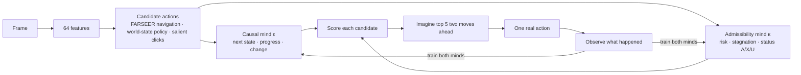

<p align="center">
  
</p>

<p align="center">
  <a href="https://www.kaggle.com/competitions/arc-prize-2026-arc-agi-3"></a>
  <a href="#at-a-glance"></a>
  <a href="#at-a-glance"></a>
</p>
<p align="center">
  <a href="https://doi.org/10.5281/zenodo.24093939"></a>
  <a href="https://www.kaggle.com/code/netphantom17/ssm-farseer-arc3-official-gateway-runner"></a>
  
  
  <a href="LICENSE"></a>
  <a href="https://www.kaggle.com/code/netphantom17/ssm-farseer-arc3-official-gateway-runner"></a>
</p>

<h3 align="center">An agent that walks into a game it has never seen, knows nothing,<br>and learns the rules while it plays. It keeps two minds: one for what will happen, one for what it can survive.</h3>

---

## At a glance

| | |
|---|---|
| **Minds** | Two separate recursive mixture-of-experts networks. Causal: **47,414** parameters. Admissibility: **41,142**. Total **88,556**. |
| **Pretraining** | None. Both start from random weights and learn only from the game in front of them. |
| **Learning** | One Adam step after every real action, on a batch of up to 8 from a 128-transition replay. Each mind has its own weights, optimizer and memory. |
| **Inputs** | 64 frame features and a 13-number action code: 9 action slots plus the click position. |
| **Thinking** | 3 recursive refinements per prediction, 2 experts mixed by a learned gate. 24 candidate actions scored per step; the top 5 imagined two moves ahead before one real move is spent. |
| **Budget** | 500 actions and 900 seconds per game by default. |
| **Code** | Under 2,000 lines of Python. |

## Why it works

**1. Predicting the next frame is not the same as staying alive.**
A model that only learns what the next frame looks like will walk straight into a game over it predicted perfectly. My paper proves the gap is not small: a forecaster that ignores what is still allowed can be forced to be wrong by nearly as much as any forecaster can, with error approaching 1 − 1/d. So DCIE never asks one network to do both jobs. The causal mind learns what an action does: the next frame, whether the level moves forward, whether anything changes at all. The admissibility mind learns what an action risks: a game over, or a move that changes nothing. Separate weights, separate optimizers, separate memories. Neither can drown the other out.

**2. Every game is new, so the agent has to learn this game, now.**
ARC-AGI-3 hands you games you have never seen. A prior trained on other games is a guess about this one. DCIE starts from nothing, and at 88,556 parameters it is small enough to train inside every action step, on the moves it has just made. It does not recall a solution. It builds one from what it witnesses.

**3. Unlikely is not impossible.**
Every candidate action carries one of three statuses.

| Status | Meaning |
|---|---|
| **A** | witnessed: I took this action here and the game went on |
| **X** | certified invalid by the official action contract |
| **U** | unknown |

Bad outcomes raise an action's risk and lower its score. They never turn it into X. Only the game's own action contract can rule a move out. One unlucky outcome never bans the move that might be the only way through. This is the same discipline as the paper's statuses, applied to play.

**4. Think before you spend a move.**
Real actions are the scarce resource. Once the agent has seen 10 transitions, it rolls its top 5 candidates two steps forward through its own learned minds, against 6 possible follow-ups each, before it commits one real action. No imagined action ever reaches the game.

**5. Trust is earned.**
Learned reward signals count for nothing at the start and ramp to full weight over the first 25 observations. Until the minds have evidence, the navigation policy and novelty steer. A visit penalty keeps it from pacing the same square.

## How it fits together



## The submission

Submission 57913002 is the official run of this notebook. It is the foundation of the agent: the scaffold, both online minds and the navigation layer, joined to the official `ARC-AGI-3-Agents` framework and played through Kaggle's gateway, with nothing pretrained. Its official score was 0.00. The folders below are that foundation exactly as submitted, and what came after it.

| Folder | What it is |
|---|---|
| `dcie/` | version 1, exactly as submitted |
| `dcie_fast/` | the same scoring rule, batched: one forward pass per candidate set instead of one per candidate |
| `dcie_v2/` | version 1 with fair scheduling: the official swarm runs every game as a thread in one process, so v2 caps how many games compute at once and starts each game's clock when it starts playing |
| `razael_chi/` | the navigation and world-state policy package the notebook carries inside it |
| `notebook/` | the submitted notebook and its metadata |

## The theory behind it

This is the agent side of my paper, [*Likely and Allowed: The Joint State of Prediction and Admissibility*](https://ivybe1337.github.io/Survival-Mechanics/) ([DOI 10.5281/zenodo.24093939](https://doi.org/10.5281/zenodo.24093939)). The paper proves that the right state for prediction under a rule is a pair: what the past makes likely, and what it still allows. DCIE is that pair, built as two learning machines.

<details>
<summary><b>Code terms → paper terms</b></summary>

| Code | Paper |
|---|---|
| Survival State Mechanics (SSM) | the joint state of prediction and admissibility |
| causal mind, transition forecast | predictive state ε |
| survival mind, survival morph evidence | evidence about the admissibility rule V |
| A / X / U | statuses A / X / U |

</details>

## Run it

DCIE plugs into the ARC Prize Foundation's [`ARC-AGI-3-Agents`](https://github.com/arcprize/ARC-AGI-3-Agents) framework.

```bash
git clone https://github.com/arcprize/ARC-AGI-3-Agents && cd ARC-AGI-3-Agents
cp ../DCIE-ARC-AGI-3/dcie/my_agent.py agents/templates/my_agent.py
cp ../DCIE-ARC-AGI-3/agents_init.py agents/__init__.py
export PYTHONPATH=../DCIE-ARC-AGI-3/dcie:../DCIE-ARC-AGI-3:$PYTHONPATH
uv run main.py --agent=myagent
```

The last cell of the notebook does exactly this against Kaggle's gateway. Knobs: `DCIE_MAX_ACTIONS` (500), `DCIE_GAME_SECONDS` (900), `DCIE_SEED` (17), and for v2 `DCIE_CONCURRENT_GAMES` (2).

## Cite

```bibtex
@software{carter_dcie_2026,
  author = {Carter, Joshua Matthew},
  title  = {DCIE: a two-mind online agent for ARC-AGI-3},
  year   = {2026},
  url    = {https://github.com/ivybe1337/DCIE-ARC-AGI-3}
}
@misc{carter_likely_allowed_2026,
  author = {Carter, Joshua Matthew},
  title  = {Likely and Allowed: The Joint State of Prediction and Admissibility},
  year   = {2026},
  doi    = {10.5281/zenodo.24093939}
}
```

## License

Everything I wrote here, code, text, method and figures, is licensed under [Creative Commons Attribution-ShareAlike 4.0 International (CC BY-SA 4.0)](LICENSE), the same license as my paper.

- **Commercial use:** allowed.
- **Credit:** required. Name *Joshua Matthew Carter (iVybe), "DCIE: a two-mind online agent for ARC-AGI-3", ARC Prize 2026*, link this repository, and say what you changed.
- **Share-alike:** anything you build from this must be released under CC BY-SA 4.0 too. You cannot fold it into a closed product.

The `ARC-AGI-3-Agents` framework and the official ARC-AGI-3 wheels belong to the ARC Prize Foundation and are not included here.

<p align="center"><sub>Joshua Matthew Carter · iVybe</sub></p>
